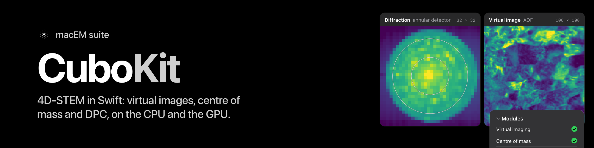

<p align="center"></p>

# CuboKit

A Swift package for 4D-STEM data on the Mac: the numbers, never the user interface. It is the Mac-native counterpart of
py4DSTEM's `DataCube`: a cube of diffraction patterns, one per scan position, and the standard first processing of it
(virtual imaging, mean and maximum patterns, centre of mass, probe size, origins, differential phase contrast), with
Accelerate on the CPU and Metal on the GPU behind one API. Headless, Swift 6 strict concurrency, one SwiftPM product per
module.

**Who it is for.** Anyone building a Mac app, a command-line tool or a notebook-style workflow on 4D-STEM data who wants
processing that is documented, tested against a reference and fast on Apple silicon, instead of writing it again.
py4DSTEM is the reference: the kit follows its definitions, names the commit it was checked against, and says where it
differs.

## Modules and their state

| Module | Scope | State |
|---|---|---|
| `CuboCore` | the cube: `CubeShape` (scan rows and columns, detector rows and columns), `CubeSource`, the eager `MemoryCube`, the lazy memory-mapped `MappedCube` (ten element types, converted to Float32 on read), NumPy's `.npy` container; `Calibration`, the cube edits (`CubeEditing`: reshape, swaps, bin, thin, pad, bilinear and Fourier resampling), `HotPixelFilter`, the ellipse fits (`EllipseFit`) | py4DSTEM pins |
| `CuboVirtual` | py4DSTEM's virtual detectors (point, circle, annulus, rectangle, any mask), virtual bright- and dark-field images, the mean and maximum diffraction pattern, on `.cpu` or `.metal`; `ResidentCube` (the cube held in one Metal buffer, with `availability(of:)`) | py4DSTEM pins; Metal within 1e-5 of the CPU |
| `CuboVirtual` (centre of mass) | the centre of mass per position (`.cpu` and `.metal`), py4DSTEM's probe size | py4DSTEM pins |
| `CuboPhase` | the centre-of-mass reference (plane fit, constant, given origins), the R–Q rotation by curl or divergence, py4DSTEM's iterative DPC, Fourier iDPC with explicit boundary/calibration | centre of mass and iterative DPC; Fourier iDPC |
| `CuboVirtual` (origins) | per-position origins (`get_origin`), centred, calibrated and centre-shifted virtual images and patterns; `CuboCore`'s `OriginFit` (`fit_origin`) | py4DSTEM pins (CPU) |
| `CuboVirtual` (median, Friedel origin, probes) | the median pattern and virtual diffraction over a real-space mask or weights (mean, max, median), `get_origin`'s scan mask and fast centre, the Friedel origin (`get_origin_friedel`, with a beamstop mask and DFT upsampling), the beamstop mask, the vacuum probe and the probe kernels (flat, Gaussian, sine² and logistic sigmoid) that Bragg disk detection uses | py4DSTEM pins (CPU) |
| `CuboParallax` | matrix-DFT cross-correlation alignment, periodic Fourier shifts and fixed/running-reference image stacks (Double, CPU; default factor 8), constant-order preprocessing, aberration fit and correction, depth sectioning, subpixel upsampling with position correction | py4DSTEM pins; `docs/parallax-alignment.md` |
| `CuboStrain` | basis selection from histogram maxima, measured-direction indexing, lattice fits, references and rotated strain tensors | CPU Double primary path; three original-source compatibility options; `docs/strain.md` |
| `CuboVirtual` (polar) | py4DSTEM's polar-elliptical cube (`PolarCube`) and radial background (`RadialBackground`) | py4DSTEM pins (CPU, Double) |
| `CuboEmbedding` | PCA and Lloyd k-means on row-major matrices; binned diffraction feature vectors; py4DSTEM's `Featurization` with NMF and Gaussian mixtures | CPU Double; scikit-learn 1.4.2 (PCA, k-means) and 1.9.1 (NMF, GMM) pins; mac4DSTEM variants as named options; `docs/embedding.md` |
| `CuboBragg` | py4DSTEM's `find_Bragg_disks`: hybrid cross-correlation with a probe kernel, maxima, the filter cascade, parabolic and multicorr refinement, per pattern, stack or cube; the app's `ProbeRingHint`; `BraggVectorClassification`, virtual images from Bragg vectors, Bragg masks | CPU Double; mac4DSTEM differences as named options; py4DSTEM and app-source pins; `docs/bragg.md` |
| `CuboPtycho` | CPU probe construction and full-batch single-slice complex-object gradient descent from preprocessed amplitudes | fixed positions; selected constraints; py4DSTEM pins |

`CuboCore` also provides `HotPixelFilter.filter` for eager Float32 cubes, plus
mean-pattern classification and single-frame replacement entry points. It follows
the pinned reference's threshold arithmetic and sequential median replacement. `FrameTransform` re-references
detector positions, scan crops and per-position origin maps under crop and bin.

`docs/parity.md` is the checklist against py4DSTEM's documented API.

## The first ten minutes

With no data at hand, `--synthetic` generates a small cube in memory. To look at a real one, export a cube from Python.
py4DSTEM's public test cube, `small_datacube.dm4` (20 × 20 × 512 × 512), is downloadable with py4DSTEM itself:

```python
import numpy as np
import py4DSTEM

py4DSTEM.io.gdrive_download("small_datacube")                   # writes small_datacube.dm4 to the working directory
datacube = py4DSTEM.import_file("small_datacube.dm4")
np.save("cube.npy", datacube.data)      # py4DSTEM's (R_Nx, R_Ny, Q_Nx, Q_Ny), C order
```

Any other `DataCube` exports the same way. Then look at it:

```sh
swift run cubo-first-look cube.npy out      # or: swift run cubo-first-look --synthetic out
```

`Examples/CuboFirstLook/main.swift` (about 150 lines) opens the cube lazily, computes the mean pattern, finds the probe
on it, makes a bright-field image with a circle on the probe, measures the centre of mass of every pattern, and writes
`mean-pattern.png`, `bright-field.png`, `com-row.png`, `com-column.png` and `numbers.json`. `--synthetic` builds a small
cube in memory, so it runs without data. The same steps as library calls:

```swift
import CuboCore
import CuboVirtual

// Lazy: nothing is read until a pass needs it.
let cube = try MappedCube(npy: URL(fileURLWithPath: "cube.npy"))
let mean = try await VirtualDiffraction.mean(of: cube)                  // get_dp_mean, in Double
let probe = try ProbeSize.estimate(mean)                                // get_probe_size: radius, centre
let bf = try await VirtualImaging.image(of: cube, geometry:
    .circle(centerRow: probe.centerRow, centerColumn: probe.centerColumn, radius: probe.radius))
let com = try await CenterOfMass.measure(of: cube)                      // com.row, com.column: detector pixels
let adf = try await VirtualImaging.image(of: cube,
    geometry: .annulus(centerRow: 31, centerColumn: 32, inner: 18, outer: 30), path: .metal)
```

**Rows and columns, never x and y.** py4DSTEM's first axis of a pair (`Rx`, `Qx`) is the kit's row; its second (`Ry`,
`Qy`) the column. A py4DSTEM geometry passes through unchanged: `((qx0, qy0), r)` is `.circle(centerRow: qx0,
centerColumn: qy0, radius: r)`. Storage is C order `[scanRow][scanColumn][detectorRow][detectorColumn]`.

## Parallax image alignment

`CuboParallax` holds the parallax pieces: CPU cross-correlation alignment with matrix-DFT subpixel refinement, preprocessing, aberration fit and correction, depth sectioning and subpixel upsampling.
The default upsampling factor is 8. Inputs and outputs use Double; translations are in row/column pixels with
periodic boundaries. A stack can use a fixed reference (default) or `runningAverage: true` as in py4DSTEM.

```swift
import CuboParallax

// Three asymmetric features in a small row-major reference image.
let alignmentRows = 8, alignmentColumns = 10
var alignmentReference = [Double](repeating: 0, count: alignmentRows * alignmentColumns)
alignmentReference[13] = 1
alignmentReference[36] = 0.7
alignmentReference[62] = 0.3
let moving = try ParallaxAlignment.shifted(alignmentReference,
    rows: alignmentRows, columns: alignmentColumns, by: .init(row: 2, column: -3))
let alignment = try ParallaxAlignment.align([moving], reference: alignmentReference,
    rows: alignmentRows, columns: alignmentColumns)
print(alignment.shifts[0])  // translation applied to moving; alignment.images and alignment.mean are row-major
```

On the four regression stacks, shifts, shifted pixels, means and DFT patches match the pinned py4DSTEM oracle
within `1e-10` normwise relative error, with a unit scale floor. This is oracle agreement, not a guarantee that an arbitrary image has an unambiguous
correlation peak. Full parallax reconstruction, detector grouping and shift regularisation remain future work.
See `docs/parallax-alignment.md` for fixture provenance, supported inputs and numerical conventions.

## How numbers are held

- **The float64 definition.** Each result is held to the float64 evaluation of py4DSTEM's definition, not to NumPy's
  float32 accumulator. py4DSTEM's own float32 results are recorded beside the float64 ones in every pin and never
  asserted against.
- **CPU reference, Metal within a stated tolerance.** `.cpu` is the default and the reference. `.metal` is checked
  against it to a tolerance fixed before the code was written (relative 1e-5 for sums, the maximum pattern bit for bit). There is no
  automatic choice of path: a number never depends on the hardware unless the caller asks for `.metal`, and every result
  records the path that made it.
- **Agreement with py4DSTEM is not validation.** It shows the port follows the definition. Truth is a closed form, a hand
  count or a planted cube, and the tests use those too. Nothing here is validated on a microscope.

| Quantity | CPU path | Metal path |
|---|---|---|
| Detector masks | identical to py4DSTEM's `make_detector` | the same mask |
| Virtual image | integer cubes bit for bit against py4DSTEM; float cubes within 1e-10 (measured: identical) | within 1e-5 of the CPU path (measured at most 2.4e-13 on real cubes) |
| Mean pattern | integer cubes bit for bit; float cubes within 1e-10 (measured: identical) | within 1e-5 (measured at most 7.6e-14) |
| Maximum pattern | bit for bit | bit for bit |
| Eager against lazy, any tiling | bit for bit | the same bits for the image; the mean within 1e-5 |
| Centre of mass, probe size | 0.0 px difference from py4DSTEM's definition evaluated in Double on five real cubes; the probe size bit for bit against py4DSTEM | within 1.9e-10 px (for patterns whose weighted sum is not tiny) |
| Median and selected patterns, beamstop masks, origins with a mask | bit for bit (medians, maxima, masks; the masked mean within 1e-10) | CPU only |
| Friedel origins, vacuum probes, kernels | within 2e-14 px; within 1e-12; within 1e-14 of py4DSTEM's (float64) kernels | CPU only |

The rotation and transpose of the DPC chain equal py4DSTEM's choice and the DPC phase is within 3.3e-12 of maximum of the
Double reference chain. Numbers are held to the Python reference within its own tolerance; `docs/parity.md` lists each function, its state and its tolerance.

## Known limits

- iOS 18 is built for the Simulator, not run; macOS 15 is tested only as a deployment target on macOS 27.
- Metal: Float32 subnormals flush to zero; the centre-of-mass claim covers |S| >= 1e-3 * sum|wP| only; not measured under memory pressure.
- Tiles larger than Metal's maximum buffer length, and Float32 overflow in Metal sums of huge finite values: not tested.
- `.npy` files with an unaligned data offset are refused.
- Friedel origins with upsampling factors of 1e4 and above, or on detectors of 1024 pixels and more: not refuted.
- `ResidentCube` holds the cube in one Metal buffer and refuses a cube above half of the physical memory or larger than the device's maximum buffer length (`ResidentCube.availability(of:)` says which).
- `Calibration` follows py4DSTEM: the edits change pixel sizes, not the origin in detector pixels.
- The polar cube, the radial background and the ellipse fits run on the CPU only; known limits are in `docs/parity.md`, open work in the GitHub issues.
- Nothing here is validated on a microscope.

## Platform

**macOS 15 or later, iOS 18 or later** (`Package.swift`, from 0.2.0). Linux is not supported yet: the kit uses Accelerate and Metal. The library, its tests and the consumer checks
build with no availability diagnostic at macOS 15 and the tests pass at that deployment target; the iOS build is checked
for the Simulator (built, not run). Apple silicon or Intel with Metal for the `.metal` path; the `.cpu` path needs only
Accelerate. Swift 6.2 tools or later, Swift 6 language mode. Build the kit optimised (`-c release`, or set the
dependency's optimisation in your app): at `-Onone` a Debug app runs it tens of times slower.

## Build and test

```sh
swift build                         # no setup, no dependency; the Metal kernels compile at run time
swift test -c release               # the gate (tools/test.sh does the same and reports skipped real-data tests)
tools/consumer-check/run.sh         # a separate package using the public API only
tools/readme-consumer/run.sh    # the README's own code, compiled and run
tools/build-docs.sh .docs-site  # the DocC site for every module (Xcode 16+); CI publishes it on a tag
```

The tests need nothing outside the package: the synthetic pins are committed. To regenerate pins, install the reference
py4DSTEM at the pinned commit (`pip install "py4DSTEM @ git+https://github.com/py4dstem/py4DSTEM@f050d207"` in a fresh
Python 3.12 environment, as the gitignored `../References/python/py4dstem` the scripts call). Then the
`pins.py` script under `tools/` for the module in question (`synthetic`) rewrites the committed pins and `real` writes exports of your own cubes outside the
repository, in `$CUBOKIT_REAL_DATA`. The real-data tests skip by name when their exports are absent,
so `tools/test.sh` runs everywhere; with the data present it runs more.

## Versioning

<!-- x-release-please-start-version -->
Semantic versions in the 0.x series, tagged; the current release is **0.10.0**. Add it to a package with

```
.package(url: "https://github.com/mac4DSTEM/CuboKit.git", from: "0.10.0")
```
<!-- x-release-please-end -->

and list the products you use (`CuboCore`, `CuboVirtual`, `CuboPhase`, `CuboParallax`, `CuboStrain`, `CuboBragg`,
`CuboPtycho`, `CuboEmbedding`). `CHANGELOG.md` has an entry per release, with a Migration paragraph where a consumer must
change something. `docs/parity.md` is the checklist against py4DSTEM's documented API, updated at every tag.

## Licence and where the parts come from

GPL-3.0-only (`LICENSE`, `NOTICE`). The whole package is GPL-3.0, so anyone who links the kit into an app or tool must license the result under GPL-3.0 or a compatible licence.

- The cube model and the reducers were extracted from the GPL-3.0 macOS app mac4DSTEM (same authors) and rewritten as a public API; `NOTICE` names
  the commit and the files.
- The detector definitions (`DetectorMask`) are a port of **py4DSTEM**'s `make_detector`, and the processing follows its
  `get_virtual_image`, `get_dp_mean`, `get_dp_max`, `get_probe_size`, `get_origin` and DPC code (GPL-3.0;
  `github.com/py4dstem/py4DSTEM`, commit `f050d207`, 0.14.19). py4DSTEM is also the reference the tests compare with.
  Please cite Savitzky et al., *py4DSTEM: A Software Package for Four-Dimensional Scanning Transmission Electron
  Microscopy Data Analysis*, Microscopy and Microanalysis 27, 712 (2021).
- The `.npy` reader and writer follow NumPy's documented format (BSD-3-Clause); no NumPy code is copied.
- `CuboEmbedding`'s PCA and k-means follow scikit-learn 1.4.2 (BSD-3-Clause), which is also the reference for their tests; no scikit-learn code is included. Its NMF and Gaussian mixture are ports of scikit-learn 1.9.1 (BSD-3-Clause), and `NumPyRandomState` ports NumPy's MT19937 `RandomState` (BSD-3-Clause).
- `MINPACKLeastSquares` is a transcription of MINPACK's `lmdif` (University of Chicago licence, with its acknowledgment in `NOTICE`); the filter and interpolation kernels follow SciPy (BSD-3-Clause). The licence texts are under `Licenses/`.

## Please cite

If you use CuboKit in published work, please cite it (`CITATION.cff`) and the reference it follows: Savitzky et al.,
*py4DSTEM*, Microscopy and Microanalysis 27, 712 (2021), doi:10.1017/S1431927621000477. GitHub's "Cite this repository" button reads `CITATION.cff`.
